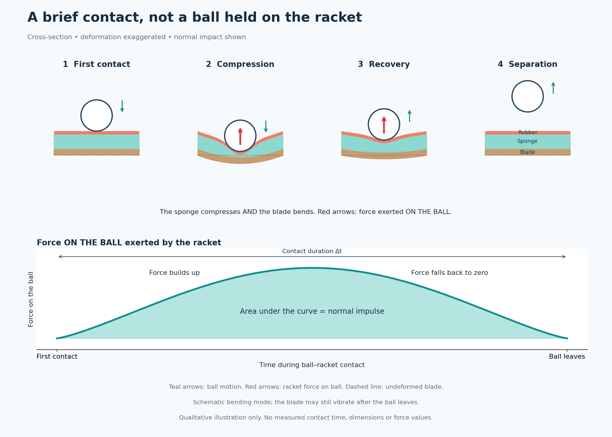
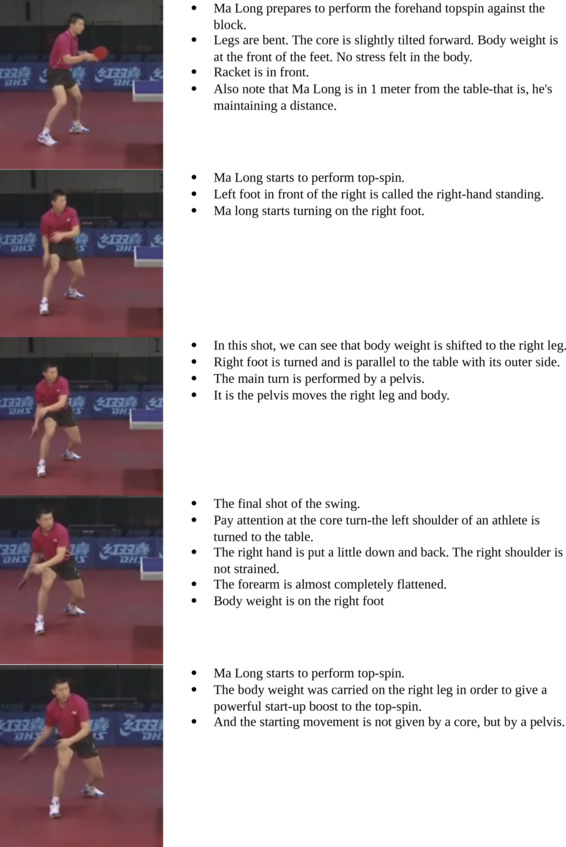
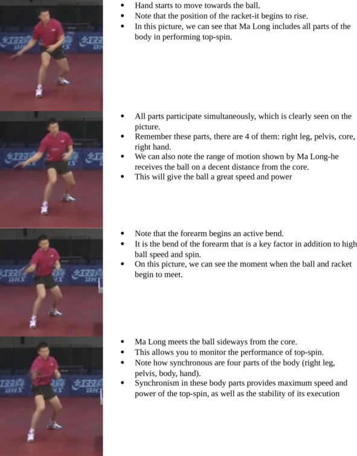
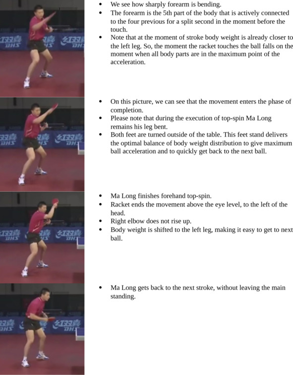
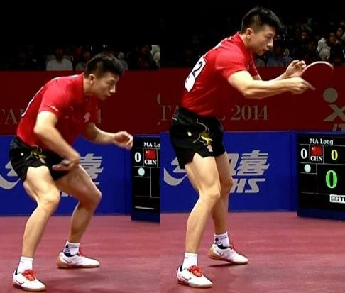

# The Physics Behind Table Tennis
## Understand school-level physics, understand the game | Ft = Δmv

**Original:** 12 October 2026 · 乒乓精进  
**Original article (Chinese):** [Read the original](https://blog.qixinge.xyz/2026/10/12/%e4%b9%92%e4%b9%93%e5%ba%95%e5%b1%82%e9%80%bb%e8%be%91%ef%bc%9a%e4%bc%9a%e4%b8%ad%e5%ad%a6%e7%89%a9%e7%90%86%ef%bc%8c%e5%b0%b1%e4%bc%9a%e6%89%93%e4%b9%92%e4%b9%93%e7%90%83-%ef%bd%9cft%ce%b4mv/)  
**English edition:** A reader-friendly translation of the complete article supplied by the user. Website counters and the duplicated phrase in the Chapter 4 heading have been omitted. The introduction and all five chapters are retained.

> **Editorial note — please read first.** The text below translates the author's coaching philosophy; it does not independently validate it. Some categorical claims are scientifically overstated, particularly those about a completely passive arm, grip pressure guaranteeing longer contact, and gentle practice having little value. These claims remain identifiable as the author's views. The illustrations and the separate physics notes at the end explain the distinctions. “Dwell time” means the brief contact between ball and racket, not a deliberate pause with the ball sitting on the rubber.

## Series introduction: You do not need advanced maths to understand table tennis

Many players spend a lifetime copying strokes and searching for an elusive “feel”. Yet striking a table-tennis ball is fundamentally a collision, with friction, governed by mechanics.

First, a clarification: **Ft = Δmv** is the impulse–momentum theorem. In the Chinese curriculum it is taught in senior high school, not junior secondary school. But the underlying idea needs only basic school physics: a stronger force, or a force acting for longer, produces a greater change in an object's motion. No calculus or complicated calculations are needed. If you understand that a force can change how something moves, you can follow this series.

Most coaches, the author argues, teach what a stroke should look like without explaining what makes it work. This series takes the opposite approach: understand the physics first, then learn the game. Rather than memorising countless technical instructions, start with the collision and its two variables, F and t. That perspective helps explain why your stroke falls apart when you hit harder, why slow drills feel so different from match play, and when equipment helps or becomes a distraction.

The aim is to use simple mechanics to explain table-tennis technique and build a dependable foundation, instead of relying on talent or a mysterious touch.

The series consists of:

1. **Introduction:** Understand school-level mechanics, understand table tennis.
2. **Chapter 1:** Why “99% of players practise the wrong way”: they do not understand Ft = Δmv.
3. **Chapter 2:** Dwell time t: where spin and margin for error come from.
4. **Chapter 3:** Impact force F: build momentum before contact; prepare slowly, release quickly.
5. **Chapter 4:** Equipment does not create power: it transmits impulse and changes the possibilities for F and t.
6. **Chapter 5:** Matches as an exchange of impulses: consistency beats going for a winner every time.

## Chapter 1 — Why “99% of players practise the wrong way”: they do not understand Ft = Δmv

Many players spend years trapped in the same cycle. Their shadow strokes look correct, their slow drills look tidy, and they know all the technical instructions. But introduce a live rally, more power or more speed, and everything breaks down: the stroke changes, the arm starts swinging wildly, and errors multiply.

Everyone worries about posture, elbow movement, feel and tiny technical details. The author's central claim is that the game is not ultimately about feel, imitation or talent: it follows **Ft = Δmv**. He presents this equation as the common foundation of every stroke, arguing that without understanding it, practice remains an imitation of technique rather than mastery of it.

### 1. What does the equation mean?

**Impulse = change in momentum.**

For the purposes of this series, the author defines the terms as follows:

| Symbol | Meaning in the article |
|---|---|
| m | The mass of the ball, taken as a constant 2.7 g. Every player is working with the same ball mass. |
| F | The force the rubber exerts on the ball at impact. The author attributes its effective source to a stable lower-body position, pushing against the floor, and explosive hip and trunk movement, rather than the hand, forearm or wrist. |
| t | The actual contact window: the brief period in which the ball and the rubber–sponge system deform against each other. This is the window in which friction can act. |

In this framework there are two routes to improvement: increase the body's explosive contribution to F, and firm the grip at contact to preserve t. The author views many small adjustments and appeals to “feel” as compensation for weaknesses in those two elements.

An important distinction: **Ft is the impulse delivered by the rubber to the ball during contact.** Leg drive and body rotation accelerate the racket beforehand. The racket's momentum then contributes to the impulse transferred during the collision.

> **Notation note:** For a varying impact force, the simple product uses the **average force**: F̄Δt = Δp = m(v_out − v_in). An instantaneous force cannot generally be multiplied by the whole contact duration. Velocity includes direction.

### 2. F: Power starts with the larger muscle groups

The author argues against trying to manufacture power by snapping the forearm or wrist. Smaller muscle groups are more likely to become tense or inconsistent when asked to supply the entire explosive action.

Instead, the main drive should come from the legs, glutes, core and trunk:

- **Forehand:** push against the floor and rotate the hips.
- **Backhand:** push against the floor and drive through the hips.

Power means a well-timed burst of acceleration, not staying tense and forcing the stroke. The body accelerates the racket so that it has speed when it meets the ball.

### 3. t: The window in which friction acts

Impact force alone, the author argues, is not enough for spin and a forgiving shot. There must also be a contact window.

Here, t runs from the ball's first contact with the rubber, through compression of the sponge, to separation. The article states that without deformation there is no t, without t there is no friction, and therefore no topspin loop.

Its main coaching cue is to **firm the grip and stabilise the racket face at contact**. Chapter 2 develops the author's explanation of how this interacts with force and equipment.

### 4. Three jobs in the author's system

**The body supplies the explosive drive.** Leg drive, hip action and trunk movement accelerate the racket and build its momentum.

**The fingers preserve the contact window.** Firming the grip is not meant to “squeeze power into the ball”. Its purpose is to stop the racket face being knocked backward or twisting at impact.

**The arm remains passive.** In the author's model, the forearm should not actively accelerate or do work. The body gives the racket speed, the grip stabilises it, and the remaining motion carries naturally into the follow-through.

### 5. Common problems, interpreted through this framework

| Problem | The author's explanation |
|---|---|
| A good-looking stroke that is unreliable in matches | Insufficient body-driven F or usable t leads the hand to compensate. |
| Technique breaks down when you hit harder | The body cannot supply enough drive, so the forearm and wrist try to make up the difference. |
| Loops lack spin or have too little arc | An unstable grip shortens the supposed friction window. |
| Rally quality varies from shot to shot | Impulse delivery is inconsistent, with last-second adjustments replacing a repeatable movement pattern. |

> **Chapter takeaway, in the author's words:** There is no mystical touch, only the law of impulse. F supplies impact; t supplies friction and forgiveness. Without understanding Ft, ten thousand repetitions are still just imitation.

## Chapter 2 — Dwell time t: where spin and margin for error come from

Most players focus on one variable: power. They think about leg drive, body rotation and acceleration. The author argues that their real ceiling is often set by the invisible, millisecond-scale contact window, t.

Chapter 1 introduced F as impact force and t as the time during which friction can act. This chapter examines how that window arises, what affects it, and what it means for practice.

### 1. What is dwell time, and why does it exist?

Dwell time is the interval between initial contact and separation, while the ball and racket covering deform. It is too brief to resolve with the naked eye.

The original compares this with a steel ball striking a steel plate, claiming that negligible deformation gives t ≈ 0 and no friction. It attributes the ability to produce topspin to the elastic rubber and sponge structure.

The article describes three stages:

1. The ball strikes the rubber and compresses the sponge.
2. The blade also bends.
3. The sponge and blade recover, releasing the ball.

The entire contact–compression–rebound process is t. In the author's explanation, elastic deformation is essential to this window.

*Added illustration: deformation is exaggerated for visibility. The ball indents the surface; it does not pass through the rubber. The force curve is schematic, with no measured millisecond values or product comparisons.*

**How to read the diagram:** The brown blade bends as the sponge compresses, then recovers; bending is exaggerated, and the blade may continue vibrating after separation. Red arrows show the force **exerted by the racket on the ball**, perpendicular to the surface. Teal arrows show the ball's motion. During compression the ball can still move toward the racket while the racket force already points away from it. The lower graph shows this force on the ball over time: it builds up and then returns to zero when contact ends. Its height is force, its horizontal span is contact duration, and the shaded area is the normal impulse delivered to the ball. It is not a ball trajectory or the player's muscular force. The opposite force acts on the racket, with equal magnitude; that is not the force plotted here. The curve is schematic, not a measured waveform.

**The author's coupling argument: sufficient F is a prerequisite for useful t.** He rejects the idea that gentle taps can train the same contact as a full attacking stroke. Without enough body-driven impact, he argues, the sponge and blade do not deform substantially, and there is no useful compression–recovery cycle.

His summary is: **force creates deformation; deformation creates a useful contact window; a stable grip preserves that window.**

### 2. What determines the length of t?

The author divides the answer into equipment potential and the player's ability to realise it. In his view, equipment sets the maximum, while adequate force and a stable racket face determine how much of it the player can use.

#### Equipment: the potential contact window

Sponge thickness, sponge hardness and blade construction are presented as setting the possible range of t.

Using Butterfly D09C as an example, the article claims:

- **2.1 mm sponge:** more compression travel and a longer deformation process under equivalent impact and grip conditions, allowing a longer t.
- **1.9 mm sponge:** less compression travel and earlier release, allowing a shorter t.

It similarly describes a resilient fibre blade such as the Fan Zhendong CNF as bending enough to extend contact, whereas a very rigid blade releases the ball sooner.

The author's emphasis is that equipment offers only potential: without sufficient impact and a stable grip, its supposed dwell-time advantage is lost.

#### The player: stabilising the racket face

According to the article, fingers and wrist that are too loose allow the racket to recoil or twist. The author claims that this prevents full compression and causes the ball to leave prematurely.

Firming the grip is therefore intended to hold the face steady, allowing the compression–recovery cycle to finish. It is not supposed to be an extra hand-powered squeeze.

The chapter's formula in words is: **equipment sets the available window; the grip lets you use it; body-driven force activates it.**

The author adds that stronger impact can deepen compression and slightly lengthen contact, provided the racket face remains stable. If it wobbles, he argues, the ball may slip off sooner instead.

### 3. How force, time and spin relate

Within the article's Ft framework, F mainly contributes to ball speed and impact, while t provides the time for friction to act.

The author argues that, for the same F, a longer t means more accumulated spin, a fuller arc and greater margin for error. For the same t, a greater F means more speed and impulse.

He presents the practical trade-off this way:

- For heavy spin and consistency, prioritise a dependable t.
- For maximum speed, increase F.

Because recreational players often lack powerful body-driven acceleration, his system prioritises preserving t rather than trying to overpower every shot.

### 4. What this means for practice

The chapter criticises very gentle rallies and slow contact drills. The author's argument is that without a real impact, the sponge does not deform enough, the stabilising grip is unnecessary, and the player is not training the same contact window used in an attacking stroke.

He describes the resulting movement as a rehearsal of appearance rather than of impact, with the forearm and wrist compensating for insufficient body drive. In his view, a quick, body-driven strike is required to activate the full sequence of force, deformation and stable contact.

The training cue is therefore: **take your time preparing; do not make the release timid.**

> **Chapter takeaway:** Deformation creates t; a stable racket face preserves it. Equipment offers the potential, the grip makes use of it, and body-driven acceleration activates it. F gives the shot its punch; t gives it heavy spin.

## Chapter 3 — Impact force F: build momentum before contact; prepare slowly, release quickly

Many players try to force the shot at the instant of contact, squeezing or snapping with the arm and wrist. The author argues that the racket's momentum should already have been built before it reaches the ball. At contact, the task is to stabilise the face and preserve the contact window, rather than start a new burst of effort.

### 1. The sequence of the stroke

1. **Before contact — preparation and acceleration:** use small adjustment steps, sit slightly back through the hips as if hovering over a low stool, take the racket back, and accelerate it through body movement. This builds the momentum needed for the collision.
2. **At contact:** the article instructs the player to stop adding leg drive or rotation and simply firm the grip to hold the face steady.
3. **After contact:** let the stroke follow through under its remaining momentum, then use the legs to recover. The racket can no longer exert contact force on a ball that has left it.

> The intended message is that impact force is not created by a last-second squeeze. Accelerate the racket beforehand; the collision then transfers momentum to the ball.

### 2. The main power source, and details that support it

The article identifies leg drive and hip rotation as the main source: the ground reaction force acts through the body, helping accelerate the racket. The following details are intended to reduce losses in that coordinated movement.

**Preparation: hips back, knees bent, centre of mass lowered.** Think of hovering over a small stool. The author describes this as preloading the legs and hips through a stretch–shortening cycle (SSC). Standing tall leaves less room for a spring-like drive; settling through the hips is intended to make the push more effective.

**Backswing: allow a small lag between trunk and upper arm.** As the trunk turns, the arm and racket trail slightly. The article calls this a two-link pre-stretch: the body leads and the arm follows, helping accelerate the racket head. It warns against forcibly pulling the arm backward, which it says wastes the stored elastic contribution.

**Keep the core gently engaged.** The trunk should provide a stable link between the legs and racket without breath-holding or rigidity. The author's analogy is a drive shaft: a loose middle interrupts the transfer.

**Keep the arm relaxed early in the swing.** Early tension in the forearm, wrist and fingers restricts acceleration. The article reserves the firmer grip for contact itself.

**Use adjustment steps to meet the ball in a good position.** Reaching awkwardly reduces the effectiveness of the body movement. Footwork puts the player in position to direct the stroke toward the incoming ball and send the shot forward.

**Stabilise the face so momentum is not wasted.** The author argues that an unstable racket recoils or twists and transfers less impulse. Firming the grip is presented as preserving the transfer rather than adding power itself.

### 3. Prepare slowly, release quickly

The original makes a strong claim: gentle contact has almost no value for training power. Its reasoning is that a small F fails to produce the deformation and usable t required by its system. A player may still return the ball, but, the author argues, the arm and wrist learn to compensate; that movement then fails under match pressure.

He distinguishes **slow preparation** from **a hesitant release**. Footwork, weight adjustment and backswing can be rehearsed calmly to learn their shape. The striking action should then accelerate decisively through the body.

The article does allow a limited role for shadow practice and gentle tapping: learning the movement outline, weight shift and body rotation. It does not consider these sufficient for training power or its “grip to preserve t” mechanism.

### 4. The author's self-checks

- The main sense of effort is in the thighs, hips and trunk; the arm follows.
- The grip firms at contact, with a sensation of brief contact on the rubber.
- The stroke follows through naturally rather than ending in a forced forearm pull.
- The author treats a sore forearm or tense wrist as a sign of compensatory hand-powered hitting and regards that power-training attempt as ineffective.

> **Chapter takeaway:** Build momentum before contact; stabilise the face when the ball arrives. Leg drive and rotation build speed, relaxation supports the movement, and a stable grip is intended to prevent losses.

### Added visual reference: Ma Long's forehand and backhand

**Complete forehand sequence — all 3 source images, 13 frames, in reading order.**

**Part 1/3 · Preparation and backswing (frames 1–5)**

**Part 2/3 · Forward swing and contact (frames 6–9)**

**Part 3/3 · Follow-through and recovery (frames 10–13)**

*Ma Long, forehand sequence. Source: [“Forehand top-spin against a simple ball or block”, Modern Table Tennis](https://sport.wikireading.ru/39041). All three source images are included, covering preparation, acceleration, contact, follow-through and recovery. Original English annotations are retained. This is an external reference image, not a new drawing or a measurement of force.*

*Ma Long, backhand preparation and forward swing. Source: [しろのたつみ, article on raising the upper body in the backhand](https://shirotatsu.blog.jp/archives/43090783.html). These two frames show different phases, not continuous timing. Further [backhand sequence](https://www.ttline.cn/m/tushi/tujie/202203/tushi_13448.html). Image rights remain with their respective owners.*

**What to look for — added guidance:** In a right-handed forehand, observe the preparation on the player's right, body rotation, and contact in front of the body. In the backhand, observe the compact preparation in front of the torso and the coordinated forward/upward movement. Do not infer a completely passive arm or an abrupt stop at contact from still pictures. The phases depend on the incoming ball and the intended shot.

## Chapter 4 — Equipment does not create power: it transmits impulse and changes the possibilities for F and t

Many enthusiasts keep buying new blades in the hope that the next one will supply power. The author argues that equipment cannot generate it from nothing: body-driven acceleration is the source, and equipment changes how the collision transfers impulse and how contact develops.

### 1. Total racket mass

The racket's mass M does not appear explicitly in the ball's equation Ft = Δmv, but it affects momentum transfer. The author argues that a suitable mass gives the racket enough inertia to resist being knocked backward by the incoming ball.

Too much mass, however, makes repeated movement and recovery more demanding and can make power output less consistent. His recommendation is a total racket mass **no greater than 185 g**, balancing inertia with manageable handling.

### 2. Blade construction

The article attributes blade differences mainly to deformation, which it links to contact duration and force transmission. It offers the following product judgements:

| Blade | The author's assessment |
|---|---|
| Fan Zhendong CNF | A resilient fibre construction that bends moderately, extends t and helps recreational players compensate for limited F. The author considers it especially compatible with his body-driven, stable-grip system. |
| Fan Zhendong ALC | Moderate deformation and balanced contact, with less dwell-time potential; better suited, in the author's view, to players with dependable power and solid fundamentals. |
| Fan Zhendong Super ALC | Described as extremely rigid, with very little blade bending and rapid release. The author argues that it requires strong body-driven impact and can make technical development harder for players who lack it. |

The article repeats that equipment offers only potential: even its preferred CNF cannot compensate for an unstable racket face.

### 3. D09C sponge thickness

Keeping the topsheet the same, the author treats sponge thickness as a change in compression travel:

- **D09C 2.1 mm:** described as allowing longer contact, heavier spin and greater margin for error under equivalent conditions. Recommended for forehand attack, at the cost of more weight and greater recovery demands.
- **D09C 1.9 mm:** described as releasing sooner but reducing weight and aiding short pushes, quick backhand topspins and close-to-table combinations. The author says it requires greater F for the same impulse and recommends it for the backhand.

His suggested combination is **2.1 mm D09C on the forehand and 1.9 mm D09C on the backhand**: prioritise contact on the forehand and lighter, quicker handling on the backhand.

### 4. The author's selection principle

Strong players, he argues, can supply enough F even with a short t. Recreational players should therefore favour equipment that, in his view, extends t and makes the movement pattern easier to maintain.

He summarises this as: the body sets the ceiling for Ft, equipment sets the floor. Even excellent equipment cannot fix inadequate body-driven acceleration or an unstable face.

> **Chapter takeaway:** Equipment does not create power from nothing; it affects impulse transfer. Blade construction and sponge thickness shape the contact response. Experts compensate for equipment limitations with technique; recreational players can choose equipment that supports a repeatable stroke.

*Editorial clarification: the product rankings, thickness-to-dwell-time claims and 185 g recommendation above belong to the source article. They are not verified comparative test results or universal buying advice.*

## Chapter 5 — Matches as an exchange of impulses: consistency beats going for a winner every time

Once force, time, practice and equipment are considered together, the author views a match as a continuing exchange of Ft. Each shot requires control of force and a repeatable contact response.

### 1. Attack

The goal is a strong, controllable shot rather than maximum force on every ball. In the author's system, dependable body drive and a stable racket face produce spin and a ball that kicks forward after bouncing.

He favours sustained pressure close to the table over one spectacular winner. Going all-out, he argues, makes both F and t harder to control and increases errors.

### 2. Defence

Against a powerful shot, the player does not need to reply with equal effort. The article recommends moderating the response, taking pace off and controlling the contact to return the ball safely.

It attributes popping the ball up or being caught out by spin to a failure to control t, with excessive, uncontrolled sponge deformation. This is the author's explanation rather than a complete account of defensive contact.

### 3. Rallying

A rally tests repeatability, not just the power of one shot. The author calls for small adjustment steps, renewed leg and body drive, and a stable face on each stroke.

In his framework, errors arise when posture and balance stop supporting consistent F, or when the grip fails to preserve t. Last-second arm-led corrections are described as compensation that undermines reliability.

### 4. Short play over the table

Short pushes, flicks and backhand banana flicks also fit the author's Ft framework. He describes the incoming impact as small and therefore emphasises fine control, subtle body movement and a stable face to regulate length, trajectory and placement.

He warns against trying to power these shots primarily with the arm, arguing that this causes the ball to sit up and gives the opponent an easy attack.

### 5. Winning around the 1700–1800 level

The source refers to a 1700–1800 rating band without identifying the rating system. It describes the common weakness at this level as inconsistent Ft: variable arm-led power or an unreliable grip produces variable shot quality.

The author's message is that every shot need not be exceptional. A repeatable stroke and fewer avoidable errors allow points to accumulate.

> **Chapter takeaway:** A match rewards repeatable quality more than the biggest individual hit. Build a reliable attack, regulate the response in defence, and choose consistency over low-percentage winners.

---

## Added physics notes: what the simple equation does—and does not—explain

These notes are separate from the translation.

1. **Impulse uses the force over the entire contact.** In plain language, it is the area under the force–time curve. F̄Δt = m(v_out − v_in) uses the average force; the exact vector form is ∫F(t)dt = Δp. The ball's direction matters as well as its speed.
2. **Spin needs rotational mechanics.** Friction acts along the surface and produces a torque: ∫τ(t)dt = ΔL. Contact time alone does not determine spin. Surface motion, friction, incoming spin and the evolving contact force also matter. F and t cannot generally be adjusted independently.
3. **Hard contacts can still involve deformation and friction.** Sponge is not a prerequisite for either finite contact duration or spin. A gentle touch also has a real contact interval. The source's statements to the contrary are too absolute.
4. **A firmer grip does not automatically mean longer dwell time.** Grip changes the mechanical support of the racket. Its effect depends on the collision and racket system; the impulse theorem alone does not establish the source's grip or product rankings. More impact force does not universally imply longer contact either.
5. **Body drive and active arm movement can coexist.** Biomechanical research supports an important trunk contribution, but also examines shoulder, elbow and wrist action. “Relax the arm” is a useful cue against excessive tension, not a statement that the arm does no work. Likewise, do not interpret the source as an instruction to abruptly stop the body at impact. See [Iino & Kojima, forehand kinetics](https://pubmed.ncbi.nlm.nih.gov/22303787/) and [backhand energy generation and transfer](https://pubmed.ncbi.nlm.nih.gov/27111711/).
6. **Slow practice and controlled low-power contact have roles.** Rehearsing coordination differs from training maximum-speed impact. The equation does not prove that gentle practice is useless, nor that forearm fatigue by itself establishes faulty technique. A static crouch is also not, by itself, a stretch–shortening cycle.
7. **Equipment does not create energy from nothing.** It can store and return elastic energy, dissipate energy and change the rebound. The incoming ball already carries energy and momentum. No universal rule says that thicker sponge always gives longer contact or that one blade guarantees more margin for error. No exact contact duration is claimed in the illustration.

**Original article:** [乒乓底层逻辑：会中学物理，就会打乒乓球 ｜Ft=Δmv](https://blog.qixinge.xyz/2026/10/12/乒乓底层逻辑：会中学物理，就会打乒乓球-｜ftδmv/) · Translation based on the full text supplied in this conversation. Illustrations and editorial notes were added for this edition.
