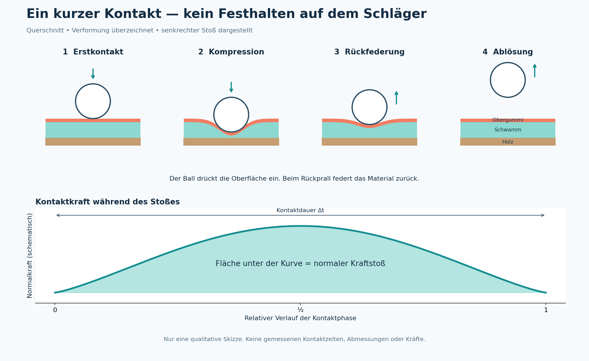

# Die Physik hinter dem Tischtennis
## Wer Schulphysik versteht, versteht auch das Spiel | Ft = Δmv

**Original:** 12. Oktober 2026 · 乒乓精进 („Besser werden im Tischtennis“)  
**Deutsche Ausgabe:** Eine verständliche Übersetzung des vollständig bereitgestellten Artikels. Die Einleitung und alle fünf Kapitel sind enthalten. Webseitenzähler und die doppelte Formulierung in der Überschrift von Kapitel 4 wurden weggelassen.

> **Redaktioneller Hinweis:** Der folgende Text gibt das Trainingskonzept des Autors wieder. Einige seiner sehr absoluten Aussagen sind wissenschaftlich nicht ausreichend begründet, etwa zum völlig passiven Arm, zur angeblich grundsätzlich längeren Ballkontaktzeit durch festeres Zugreifen und zum geringen Nutzen langsamer Übungen. Diese Aussagen sind als Position des Autors erkennbar. Die ergänzten Abbildungen und die physikalischen Hinweise am Ende stehen getrennt von der Übersetzung. Mit „Ballkontaktzeit“ ist der sehr kurze Kontakt zwischen Ball und Schläger gemeint, kein bewusstes Festhalten des Balls auf dem Belag.

## Vorwort: Man braucht keine höhere Mathematik, um Tischtennis zu verstehen

Viele Tischtennisspieler verbringen Jahre damit, Bewegungen nachzuahmen und nach dem besonderen „Ballgefühl“ zu suchen. Dabei ist ein Schlag zunächst einmal ein Zusammenstoß, bei dem auch Reibung wirkt. Er folgt den Gesetzen der Mechanik.

Eine Klarstellung vorweg: **Ft = Δmv** beschreibt den Zusammenhang zwischen Kraftstoß und Impulsänderung. Im chinesischen Schulsystem wird die Formel in der Oberstufe behandelt, nicht bereits in der unteren Sekundarstufe. Der Gedanke dahinter ist aber einfach: Je größer eine Kraft ist und je länger sie wirkt, desto stärker verändert sie die Bewegung eines Körpers. Dafür braucht man weder Integralrechnung noch komplizierte Berechnungen. Wer weiß, dass Kräfte Bewegungen verändern können, kann dieser Artikelreihe folgen.

Nach Ansicht des Autors vermitteln die meisten Trainer vor allem das äußere Bewegungsbild, ohne den zugrunde liegenden Mechanismus zu erklären. Diese Reihe geht andersherum vor: erst die Physik verstehen, dann die Technik lernen. Statt unzählige Bewegungsregeln auswendig zu lernen, soll man den Zusammenstoß und die beiden Größen F und t betrachten. Daraus will der Autor erklären, warum eine Bewegung bei höherem Krafteinsatz auseinanderfällt, weshalb langsame Übungen sich so anders anfühlen als ein Wettkampf und wann Material hilft oder in die Irre führt.

Das Ziel ist ein verlässliches technisches Fundament auf der Grundlage einfacher Mechanik — ohne sich auf Talent oder ein geheimnisvolles Ballgefühl verlassen zu müssen.

Die Reihe umfasst:

1. **Vorwort:** Wer Schulmechanik versteht, versteht Tischtennis.
2. **Kapitel 1:** Warum „99 Prozent falsch trainieren“: Sie verstehen Ft = Δmv nicht.
3. **Kapitel 2:** Die Ballkontaktzeit t: Woher Rotation und Fehlertoleranz kommen.
4. **Kapitel 3:** Die Stoßkraft F: Den Impuls vor dem Ballkontakt aufbauen — ruhig vorbereiten, schnell beschleunigen.
5. **Kapitel 4:** Material erzeugt keine zusätzliche Antriebsleistung: Es überträgt einen Kraftstoß und beeinflusst F und t.
6. **Kapitel 5:** Das Spiel als Austausch von Kraftstößen: Konstanz schlägt den riskanten Gewinnschlag.

## Kapitel 1 — Warum „99 Prozent falsch trainieren“: Sie verstehen Ft = Δmv nicht

Viele Spieler stecken jahrelang in derselben Schleife fest: Ohne Ball sieht die Bewegung sauber aus, bei langsamen Übungen stimmt der Ablauf, und die technischen Erklärungen sind bekannt. Doch sobald das Tempo steigt, mehr Druck ins Spiel kommt oder härter geschlagen wird, verändert sich die Technik. Der Arm schwingt unkontrolliert, und die Fehler häufen sich.

Dann wird über Haltung, Unterarmeinsatz, Ballgefühl und einzelne Bewegungsdetails diskutiert. Die zentrale These des Autors lautet jedoch: Entscheidend seien weder Gefühl noch Nachahmung oder Talent, sondern **Ft = Δmv**. Er bezeichnet die Formel als gemeinsame Grundlage aller Tischtennistechniken. Ohne ihr Verständnis bleibe Training aus seiner Sicht bloßes Nachahmen.

### 1. Was bedeutet die Formel?

**Kraftstoß = Änderung des Impulses.**

Für diese Artikelreihe definiert der Autor die Größen so:

| Zeichen | Bedeutung im Artikel |
|---|---|
| m | Die Masse des Balls, hier konstant mit 2,7 g angesetzt. In diesem Punkt gelten für alle Spieler dieselben Bedingungen. |
| F | Die Kraft, die der Belag beim Schlag auf den Ball ausübt. Als wirksamen Ursprung nennt der Autor einen stabilen Stand, den Abdruck vom Boden sowie eine explosive Hüft- und Rumpfbewegung. Hand, Unterarm und Handgelenk schreibt er keine wirksame Antriebsfunktion zu. |
| t | Die tatsächliche Ballkontaktzeit: der kurze Zeitraum, in dem Ball und Belag samt Schwamm gegeneinander verformt werden. In diesem Zeitfenster kann Reibung wirken. |

In diesem Modell gibt es zwei Wege zur Verbesserung: den explosiven Körpereinsatz und damit F steigern sowie beim Kontakt fester zugreifen, um t zu sichern. Viele kleinere Korrekturen und das sogenannte Ballgefühl betrachtet der Autor dagegen als Ausgleich für Defizite in diesen beiden Bereichen.

Wichtig ist die Unterscheidung: **Ft ist der Kraftstoß, den der Belag während des Kontakts auf den Ball überträgt.** Der Abdruck und die Körperdrehung beschleunigen vorher den Schläger. Dessen Impuls trägt dann beim Zusammenstoß zur Impulsänderung des Balls bei.

> **Hinweis zur Schreibweise:** Bei einer veränderlichen Stoßkraft muss im einfachen Produkt die **mittlere Kraft** stehen: F̄Δt = Δp = m(v_nach − v_vor). Eine beliebige Momentankraft lässt sich nicht einfach mit der gesamten Kontaktzeit multiplizieren. Zur Geschwindigkeit gehört auch ihre Richtung.

### 2. F: Der Antrieb kommt aus den großen Muskelgruppen

Der Autor wendet sich dagegen, die gesamte Schlagkraft aus Unterarm oder Handgelenk erzeugen zu wollen. Kleinere Muskelgruppen könnten einen explosiven Schlag weniger zuverlässig allein tragen und würden dabei leichter verspannen.

Der Hauptantrieb soll deshalb aus Beinen, Gesäß, Rumpf und Körpermitte kommen:

- **Vorhand:** vom Boden abdrücken und die Hüfte drehen.
- **Rückhand:** vom Boden abdrücken und die Bewegung über die Hüfte unterstützen.

Krafteinsatz bedeutet hier einen kurzen, gut abgestimmten Beschleunigungsimpuls, nicht dauerhaftes Anspannen. Die Körperbewegung bringt den Schläger auf Geschwindigkeit, bevor er den Ball trifft.

### 3. t: Das Zeitfenster für Reibung

Für Rotation und eine sichere Flugkurve reicht nach Ansicht des Autors die Stoßkraft allein nicht aus. Dazu brauche es eine ausreichend lange Kontaktphase.

t beginnt beim ersten Berühren des Belags und endet, wenn der Ball nach der Verformung des Schwamms wieder abspringt. Der Artikel behauptet: Ohne Verformung kein t, ohne t keine Reibung und damit kein Topspin.

Die entscheidende Trainingsanweisung lautet daher: **Beim Ballkontakt kurz fester zugreifen und das Schlägerblatt stabilisieren.** Kapitel 2 erläutert, wie der Autor das Zusammenspiel von Kraft, Kontaktzeit, Griff und Material versteht.

### 4. Drei Aufgaben im System des Autors

**Der Körper liefert den explosiven Antrieb.** Beinarbeit, Hüftbewegung und Rumpfeinsatz beschleunigen den Schläger und bauen dessen Impuls auf.

**Die Finger sichern das Kontaktfenster.** Festeres Zugreifen soll keine zusätzliche Kraft in den Ball „hineinquetschen“, sondern verhindern, dass das Schlägerblatt beim Aufprall nachgibt oder verdreht wird.

**Der Arm bleibt passiv.** Im Modell des Autors soll der Unterarm weder aktiv beschleunigen noch mechanische Arbeit leisten. Der Körper bringt den Schläger auf Tempo, der Griff stabilisiert ihn, und die verbleibende Bewegung geht von selbst in das Ausschwingen über.

### 5. Typische Probleme aus dieser Sicht

| Problem | Erklärung des Autors |
|---|---|
| Die Technik sieht gut aus, ist im Spiel aber unsicher. | Es fehlen ein ausreichendes körpergetriebenes F oder ein nutzbares t; die Hand muss ausgleichen. |
| Bei höherem Krafteinsatz zerfällt die Bewegung. | Der Körper liefert nicht genug Antrieb, deshalb springen Unterarm und Handgelenk ein. |
| Der Topspin hat wenig Rotation oder eine zu flache Flugkurve. | Ein instabiler Griff verkürzt nach dieser Erklärung das Reibungsfenster. |
| Die Schlagqualität schwankt im Ballwechsel. | Statt eines wiederholbaren Bewegungsablaufs bestimmen kurzfristige Korrekturen den Kraftstoß. |

> **Merksatz des Autors:** Tischtennis ist keine Magie des Ballgefühls, sondern folgt dem Kraftstoßgesetz. F steht für den Stoß, t für Reibung und Fehlertoleranz. Wer Ft nicht versteht, ahmt auch nach zehntausend Wiederholungen nur nach.

## Kapitel 2 — Die Ballkontaktzeit t: Woher Rotation und Fehlertoleranz kommen

Die meisten Spieler beschäftigen sich vor allem mit Kraft: Wie drücke ich mich ab? Wie drehe ich den Körper? Wie beschleunige ich? Nach Ansicht des Autors setzt häufig eine andere Größe die Grenze: die unsichtbare Kontaktzeit t im Millisekundenbereich.

Kapitel 1 hat F als Stoßkraft und t als das Zeitfenster für Reibung eingeführt. Dieses Kapitel behandelt die Entstehung, Einflussgrößen und Trainingsbedeutung dieser Kontaktphase.

### 1. Was ist die Ballkontaktzeit, und warum gibt es sie?

Sie reicht vom ersten Kontakt bis zum Ablösen des Balls, während sich Ball und Schlägerbelag verformen. Mit bloßem Auge lässt sich dieser kurze Vorgang nicht auflösen.

Das Original vergleicht ihn mit einer Stahlkugel auf einer Stahlplatte und behauptet, bei nahezu fehlender Verformung gelte t ≈ 0 und es gebe keine Reibung. Die Möglichkeit, Topspin zu erzeugen, führt es auf die elastische Struktur von Obergummi und Schwamm zurück.

Der Artikel beschreibt drei Schritte:

1. Der Ball trifft den Belag und drückt den Schwamm zusammen.
2. Das Schlägerholz biegt sich ebenfalls.
3. Schwamm und Holz federn zurück, und der Ball löst sich.

Die gesamte Folge von Berührung, Kompression und Rückfederung bildet t. In der Erklärung des Autors ist die elastische Verformung die Voraussetzung für dieses Zeitfenster.

*Ergänzte Abbildung: Die Verformung ist zur besseren Sichtbarkeit überzeichnet. Der Ball drückt die Oberfläche ein; er dringt nicht durch das Gummi. Die Kraftkurve ist schematisch und enthält weder gemessene Millisekundenwerte noch Materialvergleiche.*

**Die Kopplungsthese des Autors: Ein ausreichendes F ist die Voraussetzung für ein nutzbares t.** Sanftes Antippen trainiere aus seiner Sicht nicht denselben Kontakt wie ein Angriffsschlag. Ohne genügend körpergetriebenen Stoß würden Schwamm und Holz nicht wesentlich verformt, sodass kein wirksamer Kompressions- und Rückfederungszyklus entstehe.

Seine Kurzfassung lautet: **Kraft erzeugt Verformung, Verformung erzeugt ein nutzbares Kontaktfenster, und ein stabiler Griff erhält dieses Fenster.**

### 2. Was bestimmt die Länge von t?

Der Autor unterscheidet zwischen den Möglichkeiten des Materials und der Fähigkeit des Spielers, sie auszunutzen. Das Material lege die Obergrenze fest; ausreichende Kraft und ein stabiles Schlägerblatt bestimmten, wie viel davon im Schlag tatsächlich zur Verfügung stehe.

#### Das Material: das mögliche Kontaktfenster

Schwammdicke, Schwammhärte und Holzkonstruktion werden als Größen beschrieben, die den möglichen Bereich von t festlegen.

Am Beispiel von Butterfly D09C behauptet der Artikel:

- **2,1 mm Schwamm:** mehr Weg für die Kompression und bei gleichem Stoß und gleichem Griff eine längere Verformungsphase; dadurch sei ein längeres t möglich.
- **1,9 mm Schwamm:** weniger Kompressionsweg und eine frühere Ablösung des Balls; dadurch sei t kürzer.

Ein nachgiebiges Faserholz wie das Fan Zhendong CNF wird entsprechend als kontaktverlängernd beschrieben. Ein sehr steifes Holz gebe den Ball dagegen früher wieder frei.

Der Autor betont: Material biete nur Möglichkeiten. Ohne ausreichenden Stoß und stabilen Griff gehe der vermeintliche Vorteil verloren.

#### Der Spieler: das Schlägerblatt stabilisieren

Sind Finger und Handgelenk beim Treffen zu locker, werde der Schläger nach Darstellung des Artikels zurückgedrückt oder verdreht. Dies verhindere eine vollständige Kompression; der Ball springe zu früh ab.

Kurzes festeres Zugreifen soll deshalb die Blattstellung sichern und dem System die vollständige Kompressions- und Rückfederungsphase ermöglichen. Es soll kein zusätzlicher handgetriebener Kraftakt sein.

Die Zusammenfassung lautet: **Das Material stellt das Zeitfenster bereit, der Griff macht es nutzbar, und der Körperantrieb aktiviert es.**

Ergänzend behauptet der Autor, ein stärkerer Stoß könne den Schwamm tiefer komprimieren und den Kontakt etwas verlängern — allerdings nur bei stabilem Schlägerblatt. Wackle dieses, könne der Ball stattdessen früher abrutschen.

### 3. Wie hängen F, t und Rotation zusammen?

Im Ft-Modell des Artikels steht F vor allem für Balltempo und Stoßwirkung. t bietet die Zeit, in der Reibung wirken kann.

Bei gleichem F bedeute ein längeres t nach Ansicht des Autors mehr Rotation, eine ausgeprägtere Flugkurve und größere Fehlertoleranz. Bei gleichem t bedeute ein größeres F mehr Tempo und einen größeren Kraftstoß.

Er formuliert daraus zwei Schwerpunkte:

- Für viel Rotation und Sicherheit zuerst ein verlässliches t anstreben.
- Für maximales Tempo F steigern.

Da Freizeitspielern häufig ein starker Körperantrieb fehle, setzt sein System zunächst auf ein gesichertes t, statt jeden Ball mit maximaler Kraft schlagen zu wollen.

### 4. Konsequenzen für das Training

Das Kapitel kritisiert sehr sanfte Ballwechsel und langsame Kontaktübungen. Ohne einen kräftigen Stoß verforme sich der Schwamm nach der Argumentation des Autors nicht ausreichend. Das Stabilisieren des Griffs sei dann nicht nötig, und der Spieler trainiere nicht den Kontakt eines Angriffsschlags.

Der Autor sieht darin eher eine Nachahmung des Bewegungsbildes als eine echte Schulung des Treffens. Unterarm und Handgelenk würden einen fehlenden Körperantrieb ausgleichen. Erst ein schneller, körpergetriebener Schlag aktiviere die gesamte Folge aus Kraft, Verformung und stabilem Kontakt.

Seine Trainingsregel lautet: **Die Vorbereitung darf ruhig sein; die Beschleunigung zum Ball soll entschlossen sein.**

> **Merksatz des Autors:** Verformung schafft t, ein stabiles Blatt erhält t. Das Material bietet die Möglichkeit, der Griff nutzt sie, der Körperantrieb aktiviert sie. F gibt dem Ball Druck, t gibt ihm Rotation.

## Kapitel 3 — Die Stoßkraft F: Den Impuls vor dem Ballkontakt aufbauen — ruhig vorbereiten, schnell beschleunigen

Viele Spieler versuchen, erst beim Treffen besonders kräftig zuzupacken oder mit Arm und Handgelenk zusätzliche Kraft zu erzeugen. Der Autor hält dagegen: Der Impuls des Schlägers müsse schon vor dem Ballkontakt aufgebaut sein. Beim Treffen gehe es um die Stabilisierung des Schlägerblatts und nicht um einen neuen Kraftakt.

### 1. Die zeitliche Abfolge

1. **Vor dem Kontakt — Vorbereitung und Beschleunigung:** Mit kleinen Schritten die Position anpassen, die Hüfte etwas nach hinten nehmen, als würde man knapp über einem niedrigen Hocker sitzen, ausholen und den Schläger über die Körperbewegung beschleunigen. So entsteht der Impuls für den Zusammenstoß.
2. **Beim Kontakt:** Der Artikel fordert dazu auf, nicht weiter abzudrücken oder zu drehen, sondern lediglich kurz fester zuzugreifen und das Blatt zu stabilisieren.
3. **Nach dem Kontakt:** Die Bewegung ausschwingen lassen und mit den Beinen wieder in die Bereitschaftsposition kommen. Auf den bereits abgelösten Ball kann der Schläger keine Kontaktkraft mehr ausüben.

> Gemeint ist: Die Stoßwirkung entsteht nicht durch ein spätes Zusammenpressen der Hand. Der Schläger wird vorher beschleunigt; beim Zusammenstoß wird Impuls auf den Ball übertragen.

### 2. Der Hauptantrieb und unterstützende Details

Als Hauptantrieb nennt der Artikel den Abdruck und die Hüftdrehung. Die Bodenreaktionskraft wirkt über den Körper und unterstützt die Schlägerbeschleunigung. Die folgenden Details sollen die Bewegung besser koordinieren und Verluste verringern.

**Grundstellung: Hüfte zurück, Knie beugen, Körperschwerpunkt absenken.** Das Bild ist ein kleiner Hocker, über dem man schwebt. Der Autor beschreibt dies als Vorspannung von Beinen und Hüfte im Dehnungs-Verkürzungs-Zyklus, auf Englisch *stretch–shortening cycle* (SSC). Wer ganz aufrecht stehe, könne weniger federnd arbeiten; eine etwas tiefere Position solle den Abdruck unterstützen.

**Ausholen: Der Oberarm darf dem Rumpf leicht nachlaufen.** Wenn sich der Rumpf dreht, folgen Arm und Schläger mit einer kleinen Verzögerung. Der Autor beschreibt dies als Vorspannung eines zweigliedrigen Systems: Der Körper führt, der Arm folgt. Das soll die Endgeschwindigkeit des Schlägerkopfs erhöhen. Vom aktiven Zurückziehen des Arms rät er ab, weil dadurch seiner Ansicht nach der elastische Beitrag verloren gehe.

**Die Körpermitte leicht anspannen.** Der Rumpf soll Beine und Schlagarm stabil verbinden, ohne Luftanhalten oder Verkrampfen. Der Autor vergleicht ihn mit einer Antriebswelle: Eine instabile Körpermitte unterbreche die Übertragung.

**Den Arm zu Beginn locker lassen.** Frühzeitige Spannung in Unterarm, Handgelenk und Fingern behindere die Beschleunigung. Der festere Griff wird im Artikel für den Ballkontakt vorgesehen.

**Mit kleinen Schritten passend zum Ball stehen.** Wer sich verdreht oder weit nach dem Ball greifen muss, kann die Körperbewegung schlechter nutzen. Die Beinarbeit soll einen Treffpunkt ermöglichen, an dem sich die Bewegung sinnvoll nach vorn ausrichten lässt.

**Das Blatt stabilisieren, um die Übertragung zu sichern.** Nach Ansicht des Autors überträgt ein ausweichender oder verdrehter Schläger weniger Kraftstoß. Der Griff soll diese Übertragung sichern, nicht selbst zusätzliche Schlagkraft erzeugen.

### 3. Ruhig vorbereiten, schnell beschleunigen

Das Original formuliert sehr zugespitzt: Sanftes Treffen habe für das Training des Krafteinsatzes fast keinen Wert. Ein kleines F erzeuge weder die erforderliche Verformung noch das nutzbare t. Der Ball könne zwar zurückgespielt werden, doch Arm und Handgelenk lernten einen Ausgleichsmechanismus, der unter Wettkampfbelastung versage.

Der Autor unterscheidet deshalb zwischen **langsamer Vorbereitung** und **zögerlicher Schlagbeschleunigung**. Schritte, Gewichtsverlagerung und Ausholen dürfen bewusst und ruhig geübt werden. Die Bewegung zum Ball soll anschließend entschlossen aus dem Körper beschleunigt werden.

Trockenübungen und leichtes Antippen werden nicht vollständig verworfen. Sie sollen helfen, den groben Ablauf, die Gewichtsverlagerung und die Rumpfdrehung zu lernen. Für die Schulung von Schlagkraft und dem behaupteten „Sichern von t durch Zugreifen“ reichen sie nach Ansicht des Autors jedoch nicht aus.

### 4. Die Selbstkontrolle des Autors

- Die Anstrengung wird hauptsächlich in Oberschenkeln, Hüfte und Rumpf gespürt; der Arm folgt.
- Beim Kontakt wird kurz fester zugegriffen, verbunden mit dem Gefühl eines kurzen Ballkontakts auf dem Belag.
- Die Bewegung schwingt von selbst aus, statt durch bewusstes Heranziehen des Unterarms beendet zu werden.
- Einen ermüdeten Unterarm oder ein verspanntes Handgelenk deutet der Autor als kompensatorischen Handeinsatz und bewertet den betreffenden Versuch im Krafttraining als unwirksam.

> **Merksatz des Autors:** Den Impuls vor dem Treffen aufbauen, beim Treffen das Blatt stabilisieren. Abdruck und Drehung erzeugen Tempo, Lockerheit unterstützt die Übertragung, ein stabiler Griff soll Verluste vermeiden.

### Ergänzte Bildreferenz: Ma Longs Vorhand und Rückhand

*Ma Long, Vorhand-Bewegungsfolge. Quelle: [„Forehand top-spin against a simple ball or block“, Modern Table Tennis](https://sport.wikireading.ru/39041). Die fünf Bilder zeigen die Vorbereitung und den Beginn der Beschleunigung; die englische Originalbeschriftung bleibt erhalten. Dies ist ein externes Referenzbild, keine neu erstellte Zeichnung und keine Kraftmessung.*

*Ma Long, Rückhandvorbereitung und Vorwärtsbewegung. Quelle: [しろのたつみ, Beitrag zum Aufrichten des Oberkörpers bei der Rückhand](https://shirotatsu.blog.jp/archives/43090783.html). Die beiden Bilder zeigen unterschiedliche Phasen, aber keinen kontinuierlichen zeitlichen Ablauf. Weitere [Rückhand-Bildfolge](https://www.ttline.cn/m/tushi/tujie/202203/tushi_13448.html). Die Bildrechte liegen bei den jeweiligen Rechteinhabern.*

**Worauf achten? — Ergänzung:** Bei der Vorhand eines Rechtshänders sind die Vorbereitung auf seiner rechten Seite, die Körperdrehung und das Treffen vor dem Körper interessant. Bei der Rückhand sind es die kompakte Vorbereitung vor dem Rumpf und die abgestimmte Bewegung nach vorn und oben. Aus Einzelbildern lässt sich weder ein vollständig passiver Arm noch ein abruptes Abstoppen beim Treffen ableiten. Der konkrete Ablauf hängt von ankommendem Ball und Schlagziel ab.

## Kapitel 4 — Material erzeugt keine zusätzliche Antriebsleistung: Es überträgt einen Kraftstoß und beeinflusst F und t

Viele Spieler kaufen immer neue Hölzer und hoffen auf zusätzliche Schlagkraft. Der Autor hält dagegen: Material kann Leistung nicht aus dem Nichts erzeugen. Der Antrieb komme aus der Körperbewegung; das Material beeinflusse die Übertragung und den Kontaktverlauf.

### 1. Das Gesamtgewicht des Schlägers

Die Schlägermasse M steht nicht ausdrücklich in der auf den Ball bezogenen Gleichung Ft = Δmv, beeinflusst aber die Impulsübertragung. Eine passende Masse verleihe dem Schläger nach Ansicht des Autors genügend Trägheit, um dem ankommenden Ball standzuhalten.

Ein zu schwerer Schläger erschwere dagegen wiederholte Bewegungen und die Rückkehr in die Ausgangsposition. Dadurch könne der Krafteinsatz unbeständiger werden. Der Autor empfiehlt ein Gesamtgewicht von **höchstens 185 g**, als Kompromiss zwischen Trägheit und Handlichkeit.

### 2. Die Holzkonstruktion

Der Artikel führt Unterschiede zwischen Hölzern vor allem auf deren Verformung zurück. Daraus leitet er Unterschiede bei Kontaktzeit und Übertragung ab. Seine Produktbewertungen lauten:

| Holz | Einschätzung des Autors |
|---|---|
| Fan Zhendong CNF | Eine nachgiebige Faserkonstruktion, die sich mäßig biege und t verlängere. Das helfe Freizeitspielern, ein begrenztes F auszugleichen. Der Autor hält sie für besonders passend zu seinem körpergetriebenen System mit stabilem Griff. |
| Fan Zhendong ALC | Mittlere Verformung und ausgewogener Kontakt bei geringerem Potenzial für t. Aus seiner Sicht eher für Spieler mit zuverlässigem Krafteinsatz und gefestigten Grundlagen geeignet. |
| Fan Zhendong Super ALC | Als sehr steif mit geringer Holzbiegung und schneller Ballablösung beschrieben. Der Autor meint, es erfordere einen kräftigen Körperantrieb und könne schwächeren Spielern den Technikaufbau erschweren. |

Auch hier betont der Artikel: Material eröffnet nur Möglichkeiten. Selbst das bevorzugte CNF könne ein instabiles Schlägerblatt nicht ausgleichen.

### 3. Die Schwammdicke bei D09C

Bei gleichem Obergummi betrachtet der Autor die Schwammdicke als veränderten Kompressionsweg:

- **D09C 2,1 mm:** soll unter vergleichbaren Bedingungen längeren Kontakt, mehr Rotation und größere Fehlertoleranz ermöglichen. Empfohlen für die Vorhand, allerdings mit höherem Gewicht und höheren Anforderungen an die schnelle Rückkehr in die Ausgangsposition.
- **D09C 1,9 mm:** soll den Ball früher freigeben, dafür leichter sein und kurze Rückschläge, schnelle Rückhand-Topspins sowie tischnahes Kombinationsspiel erleichtern. Für denselben Kraftstoß sei mehr F nötig. Der Autor empfiehlt diese Dicke für die Rückhand.

Sein Vorschlag lautet: **D09C mit 2,1 mm auf der Vorhand und 1,9 mm auf der Rückhand**. Auf der Vorhand stehe die Kontaktphase im Vordergrund, auf der Rückhand das geringere Gewicht und die schnelle Schlagfolge.

### 4. Das Auswahlprinzip des Autors

Sehr gute Spieler könnten auch bei kurzem t genügend F liefern. Freizeitspieler sollten deshalb Material bevorzugen, das nach seiner Einschätzung t verlängert und einen verlässlichen Bewegungsablauf unterstützt.

Er fasst das so zusammen: Der Körper bestimme die Obergrenze von Ft, das Material die Untergrenze. Auch sehr gutes Material behebe weder unzureichenden Körperantrieb noch eine instabile Blattstellung.

> **Merksatz des Autors:** Material erzeugt keine Leistung aus dem Nichts; es beeinflusst den Kraftstoß. Holzkonstruktion und Schwammdicke prägen den Kontakt. Gute Spieler gleichen Materialgrenzen mit Technik aus; Freizeitspieler können Material wählen, das eine wiederholbare Bewegung unterstützt.

*Redaktionelle Klarstellung: Die Produktrangfolge, die Aussagen zur Schwammdicke und die Empfehlung von 185 g stammen aus dem Original. Sie sind keine hier überprüften Vergleichsmessungen und keine allgemeingültige Kaufempfehlung.*

## Kapitel 5 — Das Spiel als Austausch von Kraftstößen: Konstanz schlägt den riskanten Gewinnschlag

Nach den Überlegungen zu Kraft, Kontaktzeit, Training und Material betrachtet der Autor ein Match als fortlaufenden Austausch von Ft. Bei jedem Schlag gehe es um dosierten Krafteinsatz und einen wiederholbaren Kontakt.

### 1. Angriff

Das Ziel sei ein druckvoller, kontrollierbarer Ball und nicht bei jedem Schlag die größtmögliche Kraft. In seinem System erzeugen verlässlicher Körperantrieb und ein stabiles Schlägerblatt Rotation und einen Ball, der nach dem Aufspringen nach vorn zieht.

Der Autor bevorzugt kontinuierlichen Druck am Tisch gegenüber dem einen spektakulären Gewinnschlag. Wer ständig alles riskiere, verliere leichter die Kontrolle über F und t und mache mehr Fehler.

### 2. Abwehr

Ein druckvoller Ball müsse nicht mit ebenso großem eigenen Einsatz beantwortet werden. Der Artikel empfiehlt, Tempo herauszunehmen und die Kontaktreaktion so zu dosieren, dass der Rückschlag sicher auf dem Tisch landet.

Hoch abspringende Rückschläge und Probleme mit der Rotation erklärt er mit mangelnder Kontrolle über t und einer übermäßigen, unkontrollierten Schwammverformung. Dies ist die Erklärung des Autors, keine vollständige Beschreibung des Abwehrkontakts.

### 3. Längere Ballwechsel

Hier zählt nach seiner Auffassung nicht die Härte eines einzelnen Schlages, sondern die Wiederholbarkeit. Vor jedem Ball sollen kleine Anpassungsschritte, erneuter Bein- und Körpereinsatz sowie ein stabiles Blatt stehen.

Fehler entstehen in diesem Modell entweder durch eine nachlassende Haltung und Balance, die F unbeständig machen, oder durch einen Griff, der t nicht mehr sichere. Späte Korrekturen mit dem Arm gelten als Ausgleichsbewegungen, die die Konstanz gefährden.

### 4. Das kurze Spiel über dem Tisch

Kurzes Ablegen, Flips und Rückhand-Bananenflips ordnet der Autor ebenfalls in sein Ft-System ein. Weil der ankommende Stoß klein sei, komme es vor allem auf feine Dosierung, einen kleinen Körperimpuls und eine stabile Blattstellung an. Damit sollen Länge, Flugkurve und Platzierung gesteuert werden.

Vor einem vorwiegend armgetriebenen Schlag warnt er: Der Ball werde dann leicht zu hoch und biete dem Gegner eine gute Angriffsmöglichkeit.

### 5. Erfolgreich im Bereich von 1700 bis 1800 Punkten

Das Original nennt einen Bereich von 1700 bis 1800 Punkten, ohne das Wertungssystem zu benennen. Diese Angabe lässt sich deshalb nicht automatisch mit deutschen TTR-Punkten gleichsetzen.

Als typisches Problem beschreibt der Autor unbeständiges Ft: schwankenden, armgetriebenen Krafteinsatz oder einen unzuverlässigen Griff und damit wechselnde Ballqualität.

Seine Botschaft lautet: Nicht jeder Ball muss außergewöhnlich sein. Mit einem verlässlichen Ablauf und weniger vermeidbaren Fehlern lassen sich nach und nach Punkte gewinnen.

> **Merksatz des Autors:** Im Match zählt wiederholbare Qualität mehr als der härteste Einzelschlag. Den Angriff verlässlich aufbauen, die Abwehr dosieren und Sicherheit vor riskante Gewinnschläge stellen.

---

## Ergänzende Physik: Was die einfache Formel erklärt — und was nicht

Diese Hinweise gehören nicht zum Originaltext.

1. **Der Kraftstoß umfasst die gesamte Kontaktphase.** Anschaulich ist er die Fläche unter der Kraft-Zeit-Kurve. F̄Δt = m(v_nach − v_vor) verwendet die mittlere Kraft; exakt gilt vektoriell ∫F(t)dt = Δp. Neben dem Tempo zählt auch die Bewegungsrichtung.
2. **Für Rotation braucht man zusätzlich die Drehbewegung.** Reibung wirkt entlang der Oberfläche und erzeugt ein Drehmoment: ∫τ(t)dt = ΔL. Die Kontaktzeit allein bestimmt die Rotation nicht. Relativbewegung, Reibung, ankommende Rotation und Kraftverlauf spielen ebenfalls eine Rolle. F und t lassen sich im Allgemeinen nicht unabhängig voneinander einstellen.
3. **Auch harte Kontakte können Verformung und Reibung aufweisen.** Ein Schwamm ist weder Voraussetzung für eine endliche Kontaktzeit noch für Rotation. Auch sanftes Antippen hat einen echten Kontaktzeitraum. Die gegenteiligen Aussagen im Original sind zu absolut.
4. **Festeres Zugreifen bedeutet nicht automatisch längeren Kontakt.** Der Griff verändert die mechanische Abstützung des Schlägers. Was das bewirkt, hängt vom gesamten Stoßvorgang ab. Aus dem Kraftstoßgesetz allein folgen weder die Grifftheorie noch die Produktrangfolge des Artikels. Auch mehr Stoßkraft bedeutet nicht grundsätzlich mehr Kontaktzeit.
5. **Körperantrieb und aktiver Armeinsatz schließen sich nicht aus.** Biomechanische Arbeiten belegen einen wichtigen Rumpfbeitrag und untersuchen zugleich Schulter-, Ellenbogen- und Handgelenkaktionen. „Den Arm locker lassen“ ist eine Anweisung gegen übermäßige Spannung, keine Aussage, dass der Arm keine Arbeit leistet. Ebenso sollte der Körper beim Treffen nicht bewusst abrupt abgestoppt werden. Siehe [Iino & Kojima zur Vorhand](https://pubmed.ncbi.nlm.nih.gov/22303787/) und [zur Energieerzeugung und -übertragung bei der Rückhand](https://pubmed.ncbi.nlm.nih.gov/27111711/).
6. **Langsames Üben und kontrollierte Schläge mit wenig Kraft haben ihren Platz.** Koordination zu üben ist etwas anderes als maximale Schlaggeschwindigkeit zu trainieren. Die Formel beweist weder die Nutzlosigkeit sanfter Übungen noch, dass Unterarmermüdung allein eine falsche Technik belegt. Eine statische Kniebeuge ist außerdem noch kein Dehnungs-Verkürzungs-Zyklus.
7. **Material erzeugt keine Energie aus dem Nichts.** Es kann elastische Energie aufnehmen und zurückgeben, Energie dissipieren und den Rückprall verändern. Bereits der ankommende Ball trägt Energie und Impuls. Eine allgemeine Regel „dickerer Schwamm = längerer Kontakt“ oder eine garantierte Fehlertoleranz eines bestimmten Holzes lässt sich daraus nicht ableiten. Die Abbildung behauptet keine exakte Kontaktzeit.

**Originalartikel:** [乒乓底层逻辑：会中学物理，就会打乒乓球 ｜Ft=Δmv](https://blog.qixinge.xyz/2026/10/12/乒乓底层逻辑：会中学物理，就会打乒乓球-｜ftδmv/) · Grundlage dieser Übersetzung ist der vollständige, im Gespräch bereitgestellte Text. Abbildungen und redaktionelle Hinweise wurden für diese Ausgabe ergänzt.
